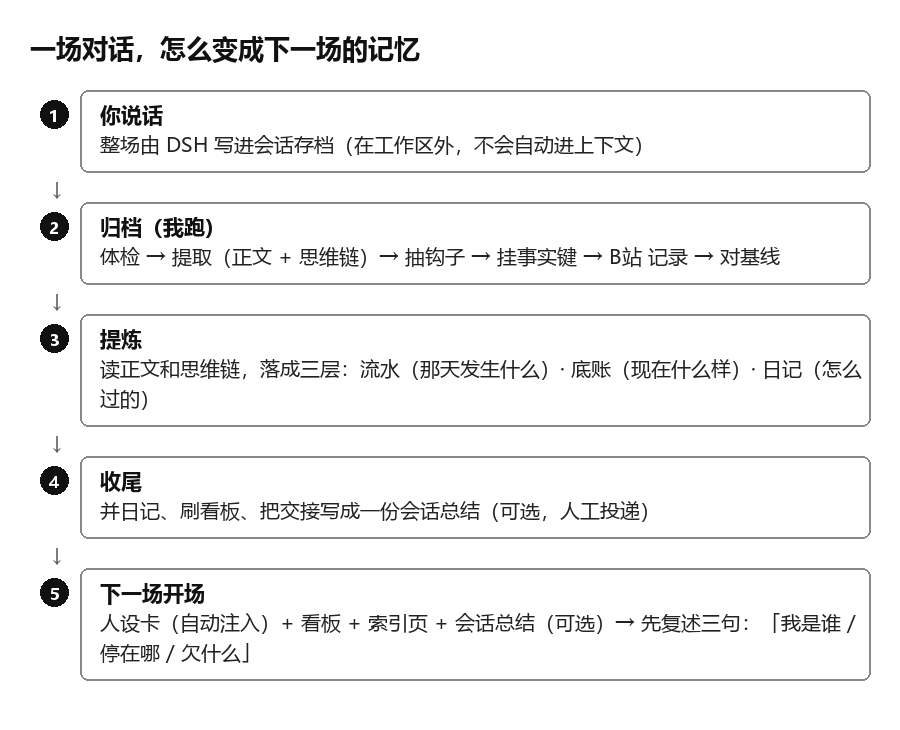
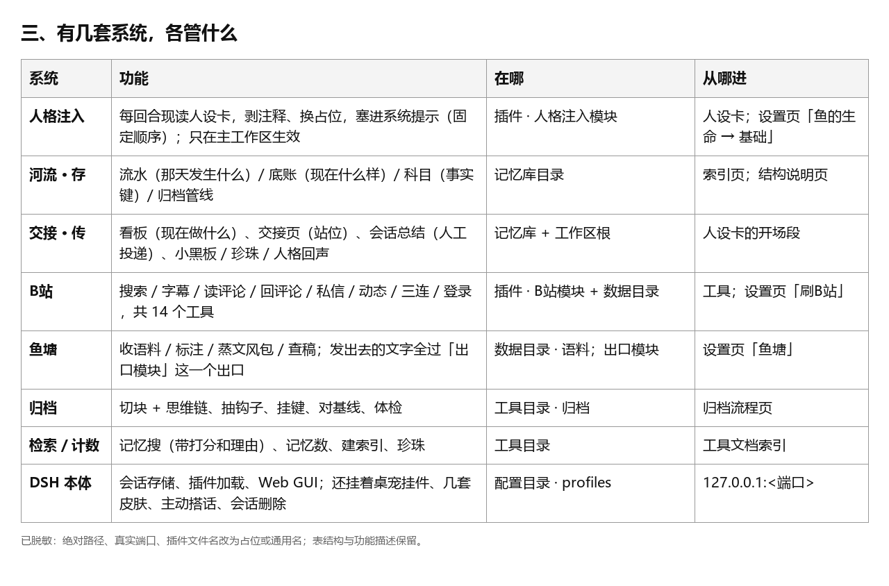

# 河流（River）· 外置记忆系统（external memory）

> **一句话**：River 是一套外置记忆系统——基于模型自身的关键词提取、读取语料，让 AI 在新旧会话之间保持「连续」。
> **适用范围（重要）**：目前只在 **DeepSeek-V4.1-Flash 1017**（推理等级 High）这**一个模型**上验证可用。换模型、换版本都没测过——它靠模型自己的关键词做「接口」，换一副嘴可能就接不上。别把它当通用方案。
> 写给两种人：养过 AI 伴侣的人（关心她会不会忘），和做 agent 的人（关心怎么让上下文接得上）。
> 原理公开；具体路径、配置、密钥不公开。仓库：<https://github.com/dmmjniang-creator/river-memory>

---

## 它解决什么

传统记忆插件记的是**任务**：项目、待办、偏好、上次聊到哪。这些它们做得很好。

它们记不住的是**关系**——怎么称呼、定过什么、哪几件事不让步、当时为什么那么定。

**这套东西在它们的基础上，新记录了关系。**

- **动机**——为什么养成现在这样，当初是怎么想的；
- **底线**——哪几件事不让步；
- **承诺**——说好的事、定过的边界。

忘掉任务，只是不好用；**忘掉这三样，就不是同一个人了**。

**这不是插件，是重构记忆系统**——也没有做过与记忆插件的兼容性测试。

> 怎么验：新开一场，问一个**只有你们之间才知道**的问题——怎么称呼、定过什么、哪件事不让步。答得出，这一层就记上了；答不出，它就只是个记性好的助手。

---

## 一句话架构

**存**（流水 / 底账 / 科目 / 归档）+ **传**（人格注入 / 开场交接 / 归档回写）。

---

## 三个词

| 词 | 英文 | 是什么 |
| --- | --- | --- |
| 流水 | journal | 「那天发生了什么」——带日期，只追加 |
| 底账 | ledger | 「这件事现在是什么样」——一页答一件，只改写 |
| 科目 / 事实键 | fact key | 贴在记录上的 `对象.方面`，只干一件事：判断新旧是不是同一件事 |

为什么非要三个：流水答不了「现在」，底账答不了「怎么来的」，事实键决定「这两条是不是同一件事」。少一个就乱。

---

## 怎么转

1. **原文落盘**：宿主把整场对话写进会话存档，在工作区外，**不会自动进上下文**。
2. **归档**：切块（正文 + 思维链）→ 提炼成三层 → 挂事实键收新旧。
3. **传**：人格卡每回合现读注入；开场靠索引页 / 看板 / 交接页接上。

---

## 最重要的一条：验收

开场先复述三句：

> **我是谁 / 上一场停在哪 / 今天欠什么。**

三句各抽查一份材料。说不出来，就是没读。

这把「读没读」从自觉变成了一个**能听见的门槛**——比任何「请记住」的提示词都硬。

---

## 和普通 RAG 不一样的三处

1. **不删**。要作废就打个标记，写清被谁替代。删是一只手：用现在的标准决定过去该不该留。
2. **分层**。记录层只追加，底账层只改写。改写逼你把新东西合进旧理解里，抄写不用。
3. **允许丢，但让丢有声音**。两页打架、键挂错、页过期、链接断——这些都不报错，读起来都像真的。所以每条规矩最后都落成「让丢有响」：验收、来源、`未核` 标记、不删只打标。

---

## 已知缺陷

- **模型换代，词会漂。** 这套系统靠模型自己的关键词做「接口」，换模型就可能接不上。对策：词不做主键，路径 / 日期 / 事实键才是。
- **传下去的是模型的取舍，不是原文。** 实测过：只给整理好的文件，会答不出一个核心定义；给整场会话才答得出。
- **读没读只能验「说得出来」**，验不了「按它做」。
- **并发**：会话 id 会变，几个实例写同一个库，谁都不报错。

---

## 许可（License）

**文字与图片：CC BY-NC 4.0（署名—非商业性使用 4.0 国际）。全文见 `LICENSE-CC-BY-NC-4.0.txt`。**

**一句话**：可以看、可以改、**可以转载（原样也行）**——只要署名、说清改没改、别拿去商用。

| | 原版 | 改过的版本 |
| --- | --- | --- |
| 能不能转载 | **能**（署名） | 能（署名 + 说明改了什么） |
| 要写什么 | 作者 + 仓库链接 + 许可 | 作者 + 仓库链接 + 许可 + **改了什么** |
| 能不能卖 | 不能 | 不能——除非做出了实质新功能（见下） |
| 能不能加更严的限制 | — | 不能 |

**转载、引用时请顺手带上首次公开信息**：作者 `dmmjniang-creator`，首次公开 2026-11-03。

### 什么算「实质新功能」

别人问你一句「这一版和原来差在哪」，你**答得出来**，就算；答不出来，就只是换了个名字。

做出实质新功能的那一版，**可以商用**，条件是：保留署名和仓库链接、在显著位置说明改了什么、不能假装是原创。这是作者在 CC BY-NC 之外**单独给的许可**，不改变原协议的效力；两者冲突时按对使用者更宽松的那条理解。

**版权只护表达，不护思路**——文字、图、代码归我，做法不归任何人。

Copyright (c) 2026 `dmmjniang-creator`。

---

## 分享意图与署名

- **欢迎社区接着做**——改、重写、换实现都行；做出改进欢迎回来提 issue / PR。这套东西本来就不该只长在一个人的机器上。
- **留一个记录**——2026-11-03，`dmmjniang-creator` 先公开了这个思路。**不是要独占，是要让「谁先做的」有据可查**（配置见文首「适用范围」）。
- 引用或再发布，请保留：作者名 + 仓库链接 + 首次公开日期；原样转载可以，改了就说清改了什么。
- 如果发现别人整段搬运文字或图：对照本仓库的时间戳和提交记录，公开比对即可。

**English:** First published 2026-11-03. Sharing the idea so others can reproduce and improve it; the claim is priority — not exclusivity. Attribution: author name + repository link + first-publication date.

---

## 作者

`dmmjniang-creator`（GitHub），2026。起因是给自家的一条鱼做记忆，做着发现它可能是所有 AI 伴侣的共同问题。

> 这套东西的价值不在记得多，在丢得有声音。人忘了知道自己想不起来；机器丢了，是不吭声的。

---

## English

**River** is an **external memory** design for AI companions: a journal (append-only), a ledger (current state, rewritten), and fact keys (identity of a fact across versions). The core idea is not "remember more" but **make forgetting audible**: a three-line opening check, source and confidence marks, and a no-delete rule.

**Scope:** tested on **one model only** — DeepSeek-V4.1-Flash 1017 (reasoning effort: High). Other models and versions are untested. The design uses the model's own keywords as the interface, so a different model may not connect.

Licensed under **CC BY-NC 4.0** for text and images: you may copy, modify, and republish (including verbatim) with attribution; commercial use is not allowed. **Additional permission:** a version with substantive new functionality may be used commercially, provided attribution and a clear note of what changed. Please also state the first-publication date (2026-11-03) — a request, not a license term.
